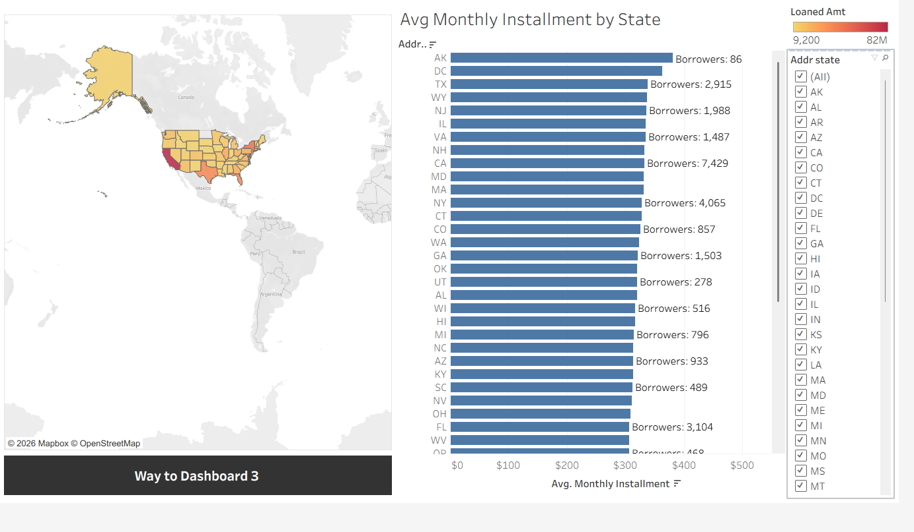
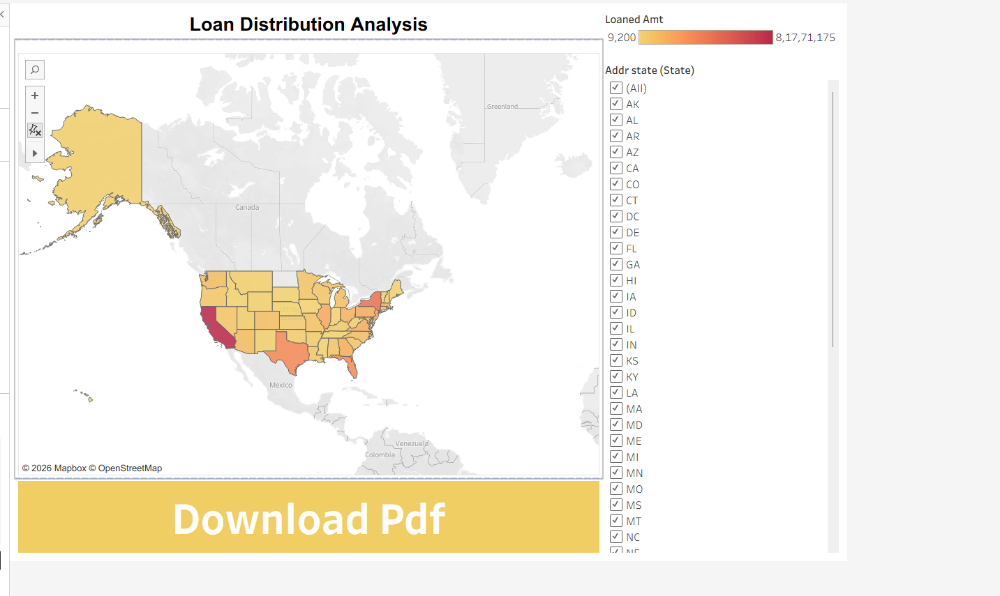
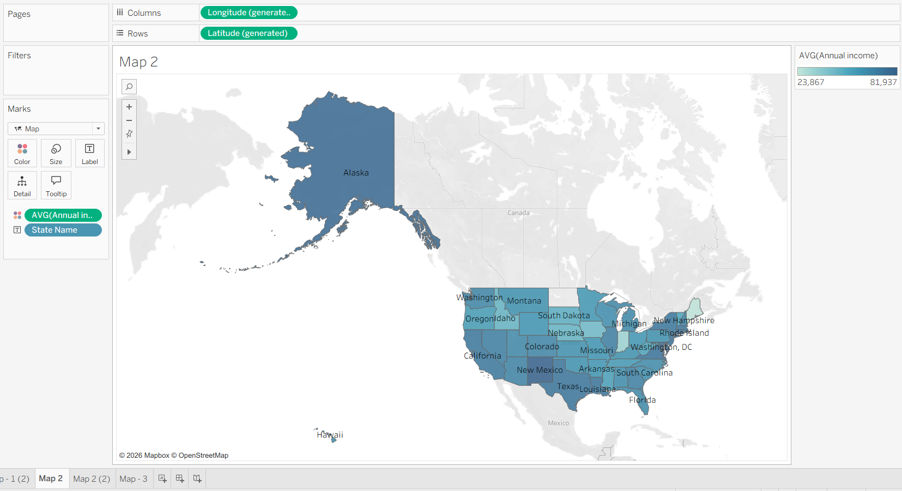
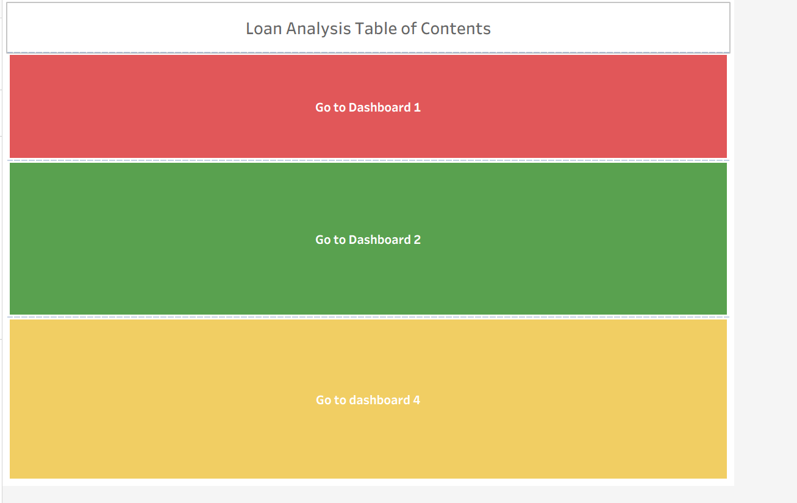

# U.S. Loan Portfolio Analytics | Tableau

**Created by Kushal Rajesh Sharma**  
**Tools:** Tableau Desktop · Microsoft Excel · Data Visualization · Exploratory Data Analysis  
**Scope:** 42,535 loan records · 29 loan-data fields · 21 worksheets · 5 dashboards

I built a Tableau portfolio analysis to explore **who borrows, why they borrow, how loan pricing varies across borrower groups, and how lending activity differs across U.S. states**. The project turns a multi-field loan dataset into comparative views, geographic visualizations, and interactive dashboards that make loan trends easier to understand.

**[Explore the dashboard screenshots](#dashboard-highlights) · [Open the Tableau workbooks](#tableau-workbooks) · [View all 22 screenshots](#complete-visualization-gallery)**

## Project objectives

- Compare borrower characteristics such as annual income, homeownership, and loan purpose.
- Investigate how **interest rates, loan size, and repayment amounts** vary by borrower segment.
- Map lending patterns across U.S. states, including focused regional analysis.
- Build interactive Tableau views using filters, calculated fields, parameters, and layered marks.
- Communicate findings through dashboards and a guided loan-analysis presentation.

## My approach and contributions

### 1. Explore and segment loan records

I connected the cleaned Excel dataset to Tableau and developed exploratory views using **loan purpose, loan status, homeownership, loan amount, and borrower income**. I organized categories with custom groups and sets, created $5,000 loan-amount bins, and built **Top N** views controlled by a parameter.

### 2. Analyze borrower behavior and pricing

I compared **median interest rates** by homeownership and borrowing purpose, and visualized average loan size by purpose using multiple mark encodings. I used aggregation and reference lines to help distinguish individual segments from overall patterns.

### 3. Build geographic and statistical views

I created filled U.S. state maps, selected-state views, a New England regional filter, a state-clustering visualization, and a layered map showing **average annual income, homeownership mix, and average debt-to-income ratio**. Additional views compare averages with reference lines, quartiles, and interval bands.

### 4. Design interactive Tableau dashboards

I built **five dashboard objects** that bring together state-level loan maps, average monthly installments, borrower counts, filter controls, navigation buttons, and explanatory text. The concluding loan-analysis narrative summarizes what the visualizations reveal.

## Key findings

These are **descriptive observations from this dataset**, not population-wide lending estimates. Rounded values come from the saved Tableau views and should be reconfirmed in the workbooks before external use.

| Finding | What the analysis showed |
| --- | --- |
| Income differs by homeownership | Average annual income was approximately **$84K for mortgage holders** compared with **$39K for the NONE category**. |
| Loan purpose is associated with different loan sizes | **Small-business loans** averaged around **$13K**, while debt consolidation had the highest observed record count (**19,776 loans**). |
| Loan pricing varies by borrower segment | Median interest rates differed across loan purposes and homeownership categories, with some groups reaching approximately **15%**. |
| Geographic variation is substantial | State maps revealed differences in average income, total loan amounts, and monthly installments. |
| State views support targeted comparisons | The dashboard combines **loan volume**, **average monthly installment**, and record-count labels in one workflow. |

## Dashboard highlights

### State loan activity and repayment comparison

The main dashboard combines a state-level loan-amount map with a horizontal comparison of **average monthly installments by state**. Filters allow a closer look at selected geographies.

### Loan distribution by geography

A filled map uses color to show relative state-level **total loan amounts**, with a state selection control for interactive analysis.

### Borrower segmentation

A grouped comparison shows how **median interest rates** change by homeownership category and loan purpose.

### Layered geographic insights

This multi-layer map combines **annual income**, **homeownership categories**, and **debt-to-income ratio** to compare geographic borrower characteristics.

### Navigating the analysis

I included a dashboard navigation page and a concluding narrative for users who want a guided overview of the project rather than individual worksheets.

## Dataset and tools

The analysis uses the **Loan_Cleaned_ISOM845** Excel dataset provided for the project. The source includes a main loan table with **42,535 records and 29 columns**, a loan-status description sheet, and a state lookup sheet. Key fields include:

- Loan amount, purpose, interest rate, monthly installment, and loan status
- Annual income, homeownership, and debt-to-income ratio
- U.S. state, loan grade, and selected credit-related measures

**Tooling:** Tableau Desktop for calculated fields, aggregation, filtering, geographic analysis, dashboards, and data storytelling; Microsoft Excel as the source format.

**Metric note:** One exploratory worksheet calculates monthly installment divided by annual income and then sums that measure by loan-status set. It should not be interpreted as an average repayment-to-income ratio.

## Tableau workbooks

The project is saved in five original Tableau workbooks. The numbered filenames reflect the original development stages; together they form this portfolio case study.

| Analysis stage | Workbook | Contents |
| --- | --- | --- |
| Data exploration | [Loan Exploration](workbooks/Assignment-02-Loan-Exploration.twbx) | 6 worksheets: groups, sets, calculations, loan bins, and parameter-driven Top N views |
| Statistical analysis | [Income, Maps and Trends](workbooks/Assignment-03-Income-Maps-and-Trends.twb) | 6 worksheets: income comparisons, map, and payment-year analysis |
| Borrower comparisons | [Borrower Comparisons](workbooks/Assignment-04-Borrower-Comparisons.twbx) | 2 worksheets: median rates and loan purpose comparisons |
| Geographic insights | [Geographic Loan Analysis](workbooks/Assignment-05-Geographic-Loan-Analysis.twbx) | 5 worksheets: state maps, regional filtering, and layered geographic marks |
| Interactive presentation | [Interactive Dashboards](workbooks/Assignment-06-Interactive-Dashboards.twbx) | 2 source worksheets and 5 dashboards, including navigation and a guided loan-analysis view |

**How to explore:** Download a packaged .twbx file and open it in Tableau Desktop. The Assignment 3 .twb is not packaged and may require reconnecting its original Excel source. The images on GitHub are static previews; native Tableau filters and navigation work inside the workbook.

## Complete visualization gallery

All **22 screenshots** are actual outputs from the Tableau workbooks, rather than mockups or recreated charts.

### Dashboards and narrative (6)

| Visualization | What it shows |
| --- | --- |
| [Portfolio dashboard](screenshots/assignment-06/dashboard-1-map-and-installments.png) | Map, state selector, and monthly installment comparison |
| [Loan distribution](screenshots/assignment-06/dashboard-4-loan-distribution.png) | Interactive lending-volume view by state |
| [State loan map](screenshots/assignment-06/loaned-amount-by-state-map.png) | State-level total loan amounts |
| [Monthly installments](screenshots/assignment-06/avg-monthly-installment-by-state.png) | Average installment and record counts by state |
| [Dashboard navigation](screenshots/assignment-06/dashboard-3-table-of-contents.png) | Navigation menu for analysis views |
| [Story conclusion](screenshots/assignment-06/story-conclusion.png) | Closing narrative and lending insights |

### Exploratory and statistical views (7)

| Visualization | What it shows |
| --- | --- |
| [Geographic clusters](screenshots/assignment-03/geographic-clusters.png) | State grouping with cluster coloring |
| [Income comparison and reference line](screenshots/assignment-03/income-constant-reference-full.png) | Income by homeownership |
| [Constant reference line detail](screenshots/assignment-03/income-constant-reference-detail.png) | Reference-line detail |
| [Average, median and quartiles](screenshots/assignment-03/income-average-median-quartiles.png) | Distribution reference bands |
| [Income interval view](screenshots/assignment-03/income-95-percent-interval.png) | Income comparison with a reference interval |
| [Loan-grade and homeownership table](screenshots/assignment-03/loan-grade-homeownership-crosstab.png) | Categorical totals and cross-tabulation |
| [Loan amount over payment years](screenshots/assignment-03/loan-amount-polynomial-line.png) | Time-based view with fitted trend (illustrative) |

### Borrower comparisons (4)

| Visualization | What it shows |
| --- | --- |
| [Interest rates by ownership and purpose](screenshots/assignment-04/interest-rates-homeownership-purpose.png) | Median interest-rate segmentation |
| [Interest-rate comparison closeup](screenshots/assignment-04/interest-rates-homeownership-purpose-closeup.png) | Detail of segmented rates |
| [Loan purpose comparison](screenshots/assignment-04/loan-purpose-marks-full.png) | Average loan amount and count encodings |
| [Loan purpose closeup](screenshots/assignment-04/loan-purpose-marks-closeup.png) | Loan amount by purpose |

### Geographic analytics (5)

| Visualization | What it shows |
| --- | --- |
| [Annual income map](screenshots/assignment-05/annual-income-map-full.png) | Income patterns across states |
| [Annual income map in Tableau](screenshots/assignment-05/annual-income-map-tableau-view.png) | Map setup in Tableau Desktop |
| [Income choropleth](screenshots/assignment-05/annual-income-map-blue.png) | Continuous income color scale |
| [Selected-state comparison](screenshots/assignment-05/income-selected-states.png) | Filtered state-level view |
| [Layered state map](screenshots/assignment-05/income-homeownership-dti-layered.png) | Income, homeownership, and debt-to-income ratio |

## Skills demonstrated

**Tableau** · **Interactive dashboards** · **Data storytelling** · **Data visualization** · **Calculated fields** · **Parameters** · **Top N filters** · **Groups and sets** · **Reference lines** · **State-level choropleth maps** · **Dual-axis/layered maps** · **Descriptive statistics** · **Borrower segmentation** · **Excel data connections**

## Project background and attribution

**Analyst and dashboard creator:** Kushal Rajesh Sharma. I developed the visualizations as part of **ISOM 845 (Tableau) at Suffolk University** and organized the original coursework into this consolidated analytics portfolio project. The repository demonstrates my own Tableau analysis, dashboard construction, and presentation work; it is **not** a commissioned client engagement, a deployed lending product, or a validated credit-risk decision system.

The owner has confirmed permission to share the dataset. Packaged .twbx files embed loan-level data. Third-party images or other externally licensed workbook content may have separate terms.

---

**[Back to top](#us-loan-portfolio-analytics--tableau)**