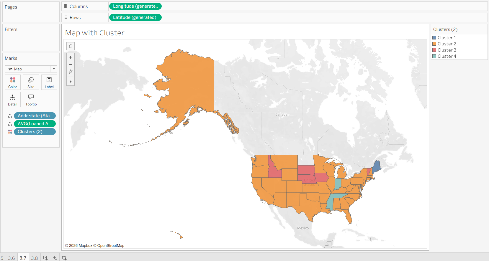
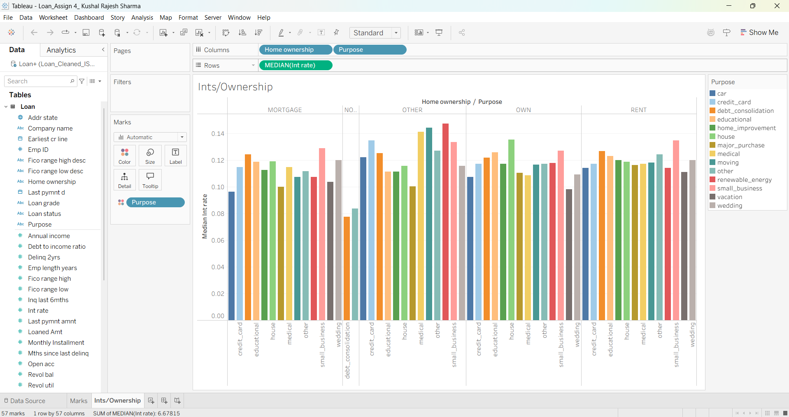

# Tableau Loan Portfolio Analytics

**Tools:** Tableau Desktop, Microsoft Excel  
**Course:** ISOM 845 — Tableau, Suffolk University  
**Project type:** Academic coursework (Assignments 2–6)

> Tableau analysis of 42,535 U.S. loan records: who borrows, how much, and at what interest rate, across borrower income, homeownership, loan purpose and state. Built as coursework for ISOM 845 at Suffolk University.


## Key findings

Approximate values read from the rendered views (Assignments 3, 4 and 5).

- **Income varies sharply by homeownership.** Average annual income is highest for mortgage holders (about $84K) and lowest for borrowers with no home ownership (about $39K).
- **Small-business loans are the largest on average (about $13K)**, while debt consolidation has by far the most loans (19,776).
- **Pricing differs by segment.** Small-business loans carry some of the highest median interest rates in the mortgage, own and rent groups (roughly 13%), and the "Other" homeownership group has the highest medians overall (up to roughly 15%).
- **Geography.** New Mexico has the highest average income among states (about $82K); Maine and Indiana are among the lowest.

**Dashboards:** Assignment 6 contains 5 interactive dashboards (state loan-amount map, monthly-installment comparison, loan distribution and a navigation-style storyboard). Open `workbooks/Assignment-06-Interactive-Dashboards.twbx` in Tableau Desktop.

## Project overview

This project uses Tableau to explore U.S. loan data across borrower characteristics, loan purposes, geography, loan amounts, interest rates, and repayment measures. The work spans five Tableau workbooks (four packaged `.twbx` and one unpackaged `.twb`), progressing from foundational data exploration and parameterized filtering to comparative charts, geographic maps, and a multi-dashboard presentation.

The five workbooks contain **21 Tableau worksheets and 5 dashboard objects** in total. The dashboards are in Assignment 6; Assignments 2, 3, 4, and 5 contain worksheets only. All use the same loan dataset (Assignment 3 is an unpackaged `.twb` that references the Excel file by a local path and does not embed it).

## Dataset

The packaged source is `Loan_Cleaned_ISOM845.xlsx` (the Assignment 4 copy has a `(2)` filename suffix). It contains three Excel sheets:

| Sheet | Contents |
| --- | --- |
| `Loan` | **42,535 loan records**, with **29 columns** including loan amount, interest rate, monthly installment, purpose, annual income, homeownership, debt-to-income ratio, state, credit measures, and loan status |
| `Loan_Description` | Loan-status descriptions |
| `State` | State abbreviations and full state names |

**Data note:** The project owner has confirmed permission to share the dataset. Packaged `.twbx` workbooks embed loan-level records, so users who download these files receive the underlying data. Any separately licensed third-party visuals should be reviewed independently.

## Workbook inventory

| Assignment | Worksheets | Dashboards | Main focus |
| --- | ---: | ---: | --- |
| 2 | 6 | 0 | Groups, sets, calculations, bins, Top N parameter |
| 3 | 6 | 0 | Annual income by homeownership, a state map, and loaned amount by last-payment year |
| 4 | 2 | 0 | Loan rates, purposes, homeownership, and income |
| 5 | 5 | 0 | Geographic maps and layered marks |
| 6 | 2 | 5 | State-level analysis and dashboard presentation |
| **Total** | **21** | **5** | |

## Tableau analysis

### Assignment 2 — Data exploration, calculations, and dynamic filtering

**Workbook:** [`Assignment-02-Loan-Exploration.twbx`](workbooks/Assignment-02-Loan-Exploration.twbx) (original filename: `ISOM 845Assingment 2 kushal Rajesh Sharma.twbx`)

Six Tableau worksheets:

- **`2.3`:** Sum of loaned amount by a loan-status set defined using the values *Charged Off* and *Fully Paid*.
- **`2.4`:** Sum of loaned amount by a custom homeownership group; the `MORTGAGE` and `OWN` categories are combined under *Owner*.
- **`2.5`:** Distribution of loan records across loan-amount bins with a **$5,000 bin size**.
- **`2.6`:** Sum of a custom *Installments to income* calculation, defined as `[Monthly_Installment] / [Annual_income]`, by loan-status set. This is how the source workbook aggregates the measure; it should not be described as the average borrower ratio.
- **`2.7`:** Top **10 employment identifiers (`Emp_ID`)** ranked by sum of monthly installments.
- **`2.8`:** Parameter-controlled **Top N employment identifiers (`Emp_ID`)** ranked by sum of monthly installments, using a `TOP N` integer parameter with a saved value of **7**.

**Demonstrated skills:** Custom groups, a status set, calculated fields, numeric bins, Top N filters, and parameter-driven analysis.

### Assignment 3 — Income, geography, and payment-year views

**Workbook:** [`Assignment-03-Income-Maps-and-Trends.twb`](workbooks/Assignment-03-Income-Maps-and-Trends.twb) (original filename: `Loan Assingment 3 Kushal Rajesh Sharma.twb`)

Six Tableau worksheets (`3.3`-`3.8`), based on their saved shelf configuration:

- **`3.3`, `3.4`, `3.6`:** Sum of annual income by homeownership category.
- **`3.5`:** Worksheet with no fields on the row/column shelves (likely a filter, text, or legend view).
- **`3.7`:** Filled map using Tableau's generated latitude/longitude.
- **`3.8`:** Sum of loaned amount by year of last payment date.

This is an unpackaged `.twb`: it holds the workbook definition only and references the Excel dataset through a local file path, so it does not embed any loan records.

**Demonstrated skills:** Aggregation by category, filled maps, and date-based (yearly) trend analysis.

### Assignment 4 — Loan and borrower comparisons

**Workbook:** [`Assignment-04-Borrower-Comparisons.twbx`](workbooks/Assignment-04-Borrower-Comparisons.twbx) (original filename: `Loan_Assign 4_ Kushal Rajesh Sharma.twbx`)

- **`Ints/Ownership`:** Median interest rate by homeownership category and loan purpose.
- **`Marks`:** Average loan amount by loan purpose, with additional encodings for income and volume-related measures.

**Demonstrated skills:** Grouped comparisons, median and average aggregations, multivariate marks, and borrower segmentation.

### Assignment 5 — Geographic loan analysis

**Workbook:** [`Assignment-05-Geographic-Loan-Analysis.twbx`](workbooks/Assignment-05-Geographic-Loan-Analysis.twbx) (original filename: `Loan_Assign 5_Sharma.twbx`)

Five map worksheets explore geographic patterns:

- **`Map - 1`:** State-level map using average annual income as color and size encodings.
- **`Map - 1 (2)`:** Income map with a top-10-state filter ranked by average annual income.
- **`Map - 3`:** Loan-amount map filtered to the six New England states: Connecticut, Maine, Massachusetts, New Hampshire, Rhode Island, and Vermont.
- **`Map 2`:** Geographic comparison of average annual income.
- **`Map 2 (2)`:** Layered map combining annual income with pie-chart marks for homeownership and average debt-to-income ratio.

**Demonstrated skills:** Geographic fields, filled maps, filtered regional analysis, layered maps, and multivariate visual encodings.

### Assignment 6 — Dashboard design and navigation

**Workbook:** [`Assignment-06-Interactive-Dashboards.twbx`](workbooks/Assignment-06-Interactive-Dashboards.twbx) (original filename: `Assingment 6.twbx`)

Two underlying worksheets:

- **`Avg Monthly Installment by State`:** State-level comparison of average monthly installment, with a distinct-record-count mark label.
- **`Loaned amount by state`:** Geographic view of total loan amount with state and loan-amount filters.

Five dashboard objects:

| Dashboard | Role in the workbook |
| --- | --- |
| `Dashboard 1` | Pairs the state loan-amount map with the monthly-installment comparison and filter controls |
| `Dashboard 2` | Loan-information panel containing an embedded illustration and an external interest-rate webpage |
| `Dashboard 3` | Table-of-contents/navigation-style layout |
| `Dashboard 4` | Loan distribution view with a state filter and loan-amount legend |
| `Loan Analysis` | Storyboard-style dashboard with navigation objects and explanatory text |

**Demonstrated skills:** Dashboard layout, maps with quantitative color legends, cross-view presentation, filter controls, contextual text, and navigation design.

## Skills demonstrated

- Tableau data connection and worksheet design
- Exploratory analysis and borrower segmentation
- Calculated fields, custom groups/sets, $5,000 numeric bins, and Top N parameters
- Aggregations: sum, median, mean, and distinct count
- Geographic analysis and New England regional filters
- Dual-axis/layered maps with pie-chart marks
- Interactive dashboard layout and filter controls
- Business-oriented data storytelling

## Portfolio gallery — 16 Tableau screenshots

The figures below are actual screenshots of the Tableau workbooks, grouped by assignment. Screenshots illustrate worksheet outputs; they are not a substitute for interacting with the workbooks.

### Featured visualizations

**Geographic analysis — annual income, homeownership and debt-to-income ratio (Assignment 5)**


**Geographic segmentation — clustered states (Assignment 3)**



**Borrower comparison — interest rates by homeownership and loan purpose (Assignment 4)**



### All screenshots

| Assignment | Screenshot | What it demonstrates |
| --- | --- | --- |
| 3 | [Income vs. a constant reference line](screenshots/assignment-03/income-constant-reference-full.png) | Reference line against category averages |
| 3 | [Constant reference line detail](screenshots/assignment-03/income-constant-reference-detail.png) | Reference-line detail |
| 3 | [Mean, median and quartile reference](screenshots/assignment-03/income-average-median-quartiles.png) | Distribution reference markers |
| 3 | [Homeownership × loan grade table](screenshots/assignment-03/loan-grade-homeownership-crosstab.png) | Cross-tabulation and grand totals |
| 3 | [95% interval view](screenshots/assignment-03/income-95-percent-interval.png) | Income comparison with reference interval |
| 3 | [Geographic clusters](screenshots/assignment-03/geographic-clusters.png) | Cluster-based map coloring |
| 3 | [Loan amount over last payment year](screenshots/assignment-03/loan-amount-polynomial-line.png) | Trendline illustration; avoid extrapolating beyond observed years |
| 4 | [Loan purpose / marks](screenshots/assignment-04/loan-purpose-marks-full.png) | Average loan amount with other visual encodings |
| 4 | [Loan purpose close-up](screenshots/assignment-04/loan-purpose-marks-closeup.png) | Average loan amount by purpose |
| 4 | [Median interest rate by borrower segment](screenshots/assignment-04/interest-rates-homeownership-purpose.png) | Homeownership and loan-purpose comparisons |
| 4 | [Interest rate chart close-up](screenshots/assignment-04/interest-rates-homeownership-purpose-closeup.png) | Focused comparison of median interest rates |
| 5 | [Income by state](screenshots/assignment-05/annual-income-map-full.png) | Choropleth-style geographic mapping |
| 5 | [Selected states](screenshots/assignment-05/income-selected-states.png) | Filtering states for focused analysis |
| 5 | [Income map in blue](screenshots/assignment-05/annual-income-map-blue.png) | Continuous quantitative color legend |
| 5 | [Layered income / homeownership / DTI](screenshots/assignment-05/income-homeownership-dti-layered.png) | Multiple marks layers and pie composition |
| 5 | [Map in Tableau workspace](screenshots/assignment-05/annual-income-map-tableau-view.png) | Source field configuration and visual context |

Assignments 2 and 6 are included as **Tableau workbook files**; there are no screenshots from those assignments in this gallery yet.

## Reproduce and explore

1. Open the original `.twbx` files in a compatible version of Tableau Desktop.
2. Inspect the worksheets in Assignments 2, 3, 4, and 5 (Assignment 3 needs the original Excel file re-linked).
3. Open Assignment 6 and navigate its dashboard views.
4. Review the filters, map layers, marks cards, and chosen aggregations.

Figures in Key findings are approximate values read from the rendered views (Assignments 3, 4 and 5); confirm them in the workbooks before quoting them elsewhere.

## Repository structure

```text
Tableau-Loan-Portfolio-Analytics/
├── README.md
├── .gitignore
├── workbooks/
│   ├── Assignment-02-Loan-Exploration.twbx
│   ├── Assignment-03-Income-Maps-and-Trends.twb
│   ├── Assignment-04-Borrower-Comparisons.twbx
│   ├── Assignment-05-Geographic-Loan-Analysis.twbx
│   └── Assignment-06-Interactive-Dashboards.twbx
├── screenshots/
│   ├── assignment-03/ (7 PNGs)
│   ├── assignment-04/ (4 PNGs)
│   └── assignment-05/ (5 PNGs)
└── docs/
    ├── workbook-inventory.csv
    ├── resume-and-linkedin.md
    └── data-sharing-and-publication.md
```

## Publication status

- **Repository visibility:** Public; the project owner has confirmed permission to share the coursework dataset.
- **Available:** Five original Tableau workbooks and 16 original screenshots, plus documentation.
- **Note:** Tableau packaged `.twbx` files include source data. Third-party images and other bundled assets may have separate usage rights; confirm those as needed.
- These materials show academic Tableau work, not production deployment or independently validated commercial outcomes.
